# GEM Architecture

## Overview

This repository contains a **RTL logic simulator** that leverages
CUDA-compatible GPUs to achieve 5-40X speedup compared to traditional CPU-based
RTL simulators. GEM operates on principles similar to FPGA-based emulators by
synthesizing designs into And-Inverter Graphs (AIGs) and mapping them to a
virtual manycore Boolean processor architecture that executes on GPUs.

## High-Level Flow

Legend:

🔧 Tool: The software or code module used

📚 Library: Standard cell libraries or dependencies (where applicable)

⚙️ Functions

▸ Operations: What the step does

📝 Code scripts

📦 In-memory Rust data structures

📄 File

```mermaid
---
config:
      theme: redux
      look: classic
      layout: elk
---
flowchart TD
    RTL(["📄 RTL Design<br/>(Verilog/SystemVerilog)"])

    subgraph Synthesis ["Synthesis "]
    mem_lib(["📚 memlib_yosys.txt"])
    aig_lib(["📚 aigpdk.lib / aigpdk_nomem.lib"])

    mem_synth["<b> Memory Synthesis</b><br/>▸ Map RAM blocks to $__RAMGEM_SYNC_<br/>▸ We don't want to simulate the (sync) memory when we can just use GPU memory instead.  <br/>  🔧 Yosys<br/> 📝 A design specific Yosys (.ys) or TCL (.tcl) script"]

    mem_mapped(["📄 memory_mapped.v"])

    log_synth["<b>Logic Synthesis</b><br/>▸ Convert to AIG by synthesising to AIG cells (AND2X0, INVX0, DFF*)<br/>🔧 DC Compiler / Yosys<br/> 📝 A design specific Yosys (.ys) or TCL (.tcl) script"]
    end
    gatelevel(["📄 gatelevel.gv"])
    mem_lib --> mem_synth --> mem_mapped
    mem_mapped --> log_synth
    aig_lib --> log_synth
    Synthesis--> gatelevel

    subgraph GEM ["GEM Compilation Pipeline (compile)"]
    direction TB

    parse["<b> Parse & Build AIG</b><br/>▸ Parses the Verilog AIG, flattens hierarchy, builds AIG data structure<br/>📝 crates/aig/"]

    aig_struct(["📦 AIG"])

    staging["<b> Vertical Splitting</b><br/>▸ Split circuit by depth into stages<br/>▸ Necessary to reduce RepCut replication cost<br/>📝 crates/staging/"]

    staged_aigs(["📦 Vec&lt;StagedAIG&gt; <br/>▸Multiple AIG stages"])

    repcut["<b>Horizontal Partitioning (RepCut)</b><br/> Individually partition each AIG stage using RepCut<br/>▸ RepCut hypergraph clustering<br/>📝 crates/repcut/"]

    partition_assignments(["📦 Vec&lt;usize&gt; <br/>▸Partition assignments"])

    build_boomerang["<b>Build Boomerang Layers</b><br/>▸ Build boomerang hierarchies for each partition<br/>▸ Tree reduction (8192→4096→...→1)<br/>📝 crates/flatten/src/pe.rs"]

    partitions(["📦 Vec&lt;Partition&gt; <br/>▸Each partition contains Vec&lt;BoomerangStage&gt;"])

    flatten["<b>Flatten to GPU Code</b><br/>▸ Schedule partitions onto GPU blocks<br/>▸ Allocate memory for states<br/>▸ Generate GPU instructions<br/>📝 crates/flatten/"]
    end
    gpu_script(["📄 result.gemparts"])

    subgraph Simulation ["GPU Execution (gem-simulator / simulator)"]
    gpu_sim["<b>GPU Simulation</b><br/>▸ Runs the simulation kernel <br/>▸ Update flip-flops, SRAM, outputs<br/>📝 crates/gem-cuda/ + crates/gem-simulator/"]
    end

    out_vcd(["📄 output.vcd"])
    in_vcd(["📄 input.vcd"])
    RTL --> Synthesis
    gatelevel --> GEM
    parse --> aig_struct --> staging -->staged_aigs --> repcut --> partition_assignments --> build_boomerang --> partitions --> flatten
    GEM--> gpu_script --> Simulation
    in_vcd --> Simulation --> out_vcd

```

## References

- **Paper**: "GEM: GPU-Accelerated Emulator-Inspired RTL Simulation" (DAC 2025)
- **ABC**: [ABC Tool](https://people.eecs.berkeley.edu/~alanmi/abc/)
- **Partitioning**: [KaHyPar](https://github.com/kahypar/kahypar)
- **CUDA Programming Intro**:
  [What Exactly is CUDA?](https://www.modular.com/blog/democratizing-compute-part-2-what-exactly-is-cuda)
- GPU Glossary: [CUDA Glossary](https://modal.com/gpu-glossary)
- **CUDA Toolkit**:
  [NVIDIA CUDA Toolkit](https://developer.nvidia.com/cuda-toolkit)
